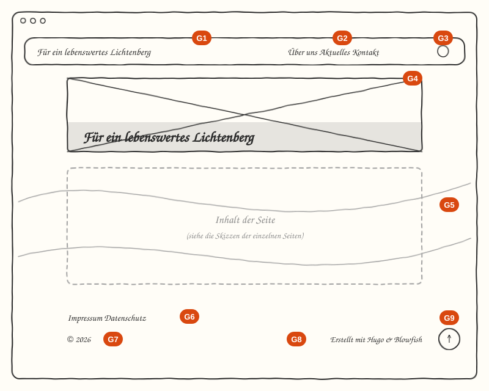
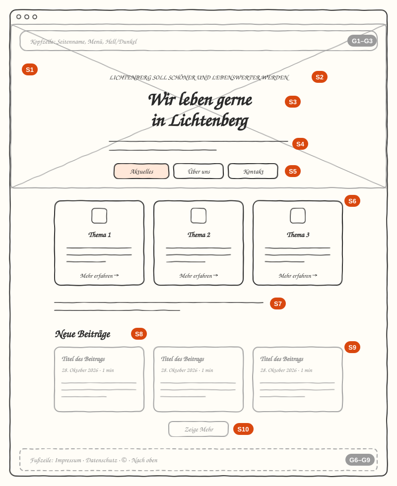
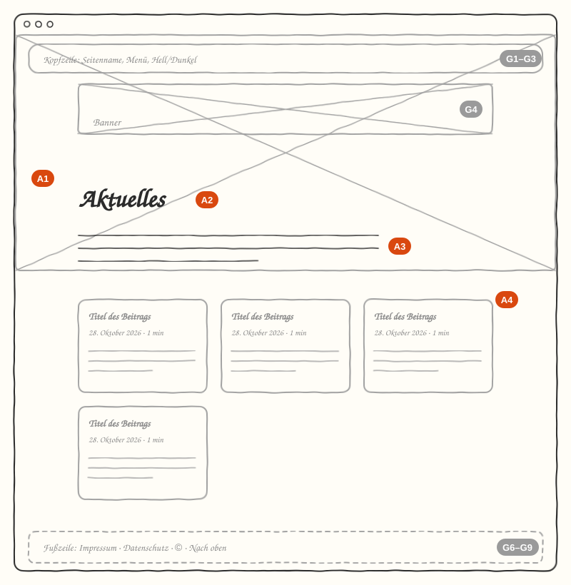
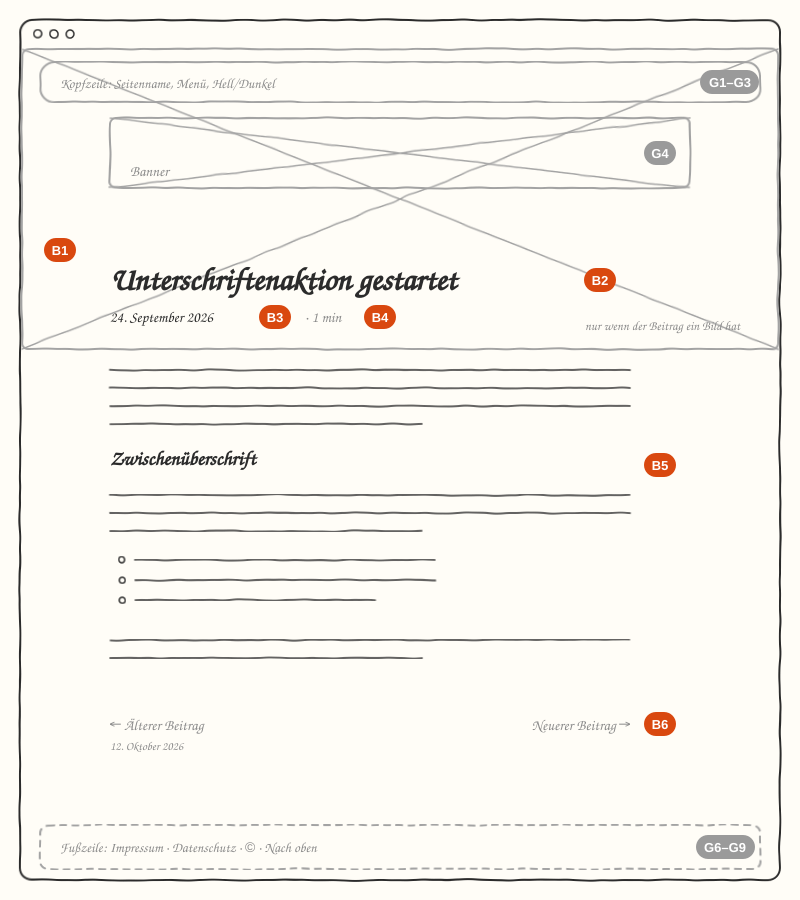
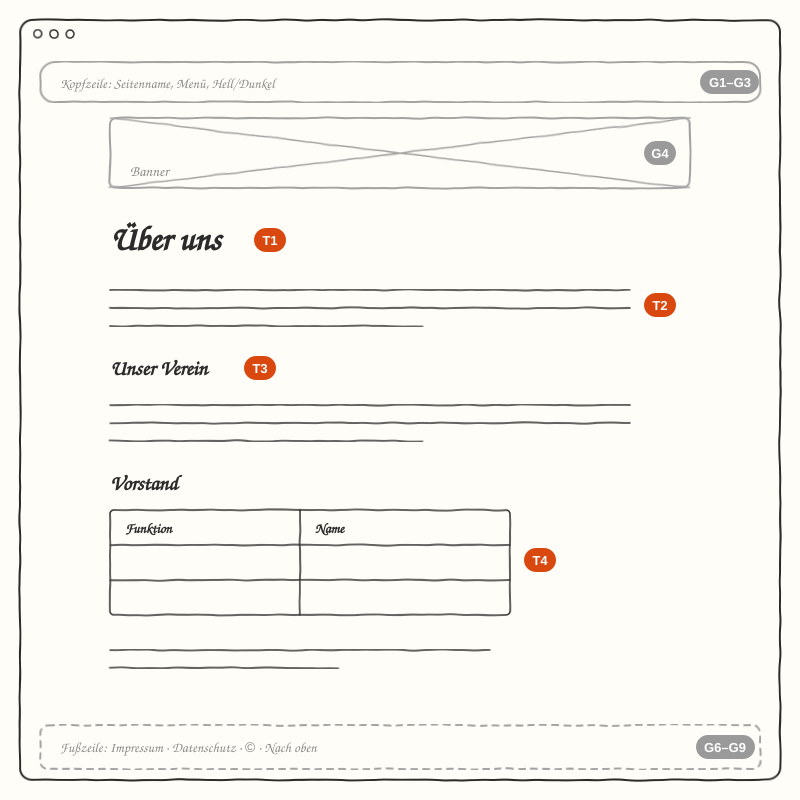
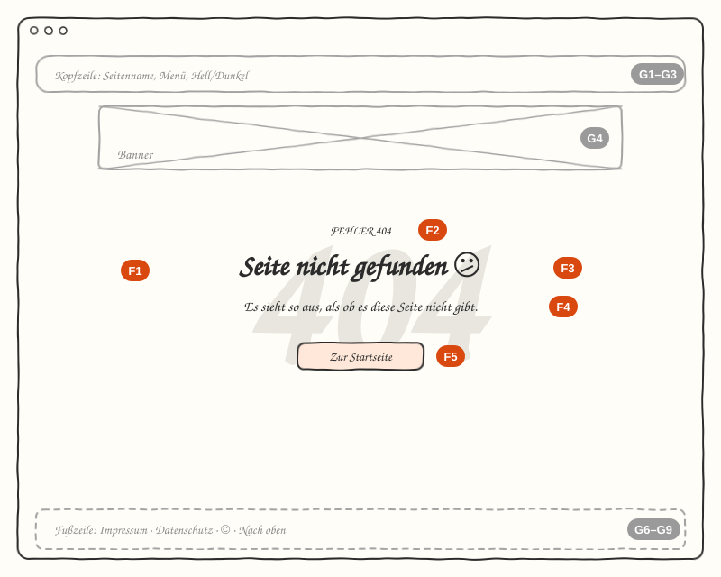

# Inhaltskarte

Diese Karte zeigt alle Bausteine der Website „Für ein lebenswertes Lichtenberg“. Für jeden Baustein steht hier, wofür er da ist, wie viel Text oder welches Bild hineinpasst und in welcher Datei er gepflegt wird.

## So lesen Sie die Karte

- Jede Seitenart hat eine **Skizze**. Die Skizzen sind bewusst grob gezeichnet: Sie zeigen die Anordnung, nicht das endgültige Aussehen.
- Jeder Baustein hat eine **ID** aus Buchstabe und Zahl, zum Beispiel `S3` für die Schlagzeile der Startseite.
- **Orange Marken** zeigen die Bausteine der jeweiligen Seite. **Graue Marken** verweisen auf die gemeinsamen Bausteine, die auf jeder Seite gleich sind (`G1` bis `G9`).
- **Schwarz** gezeichnete Bausteine füllen Sie mit Inhalt. **Grau** gezeichnete Bausteine füllt die Website selbst oder sie sind fest eingestellt.
- Die Längen sind **Empfehlungen**, gemessen auf Handy (375 Pixel breit) und Computer. Längere Texte funktionieren auch, brechen aber in mehr Zeilen um oder werden abgeschnitten.

**Inhalte liefern:** Schicken Sie Texte und Bilder mit der ID des Bausteins, zum Beispiel „S3: Gemeinsam für unsere Wiesen“. Wer direkt in den Dateien arbeitet, findet in der Spalte „Wo eintragen“ die Datei und das Feld. Wie man Dateien bearbeitet, steht in der [README des Projekts](../../README.md#editing-content).

| Seite | Adresse | Skizze |
| --- | --- | --- |
| Alle Seiten | | [Gemeinsame Elemente](#gemeinsame-elemente-g) |
| Startseite | `/` | [Startseite](#startseite-s) |
| Aktuelles | `/aktuelles/` | [Aktuelles](#aktuelles-a) |
| Jeder Beitrag unter Aktuelles | `/aktuelles/…/` | [Beitrag](#beitrag-b) |
| Über uns, Kontakt, Impressum, Datenschutz | `/ueber-uns/` usw. | [Textseite](#textseite-t) |
| Fehlerseite bei falscher Adresse | | [Fehlerseite](#fehlerseite-f) |

## Gemeinsame Elemente (G)

Diese Bausteine stehen auf jeder Seite. Die meisten sind fest eingestellt. Änderungen daran übernimmt, wer die Website technisch betreut.



| ID | Baustein | Wofür | Umfang | Wo eintragen |
| --- | --- | --- | --- | --- |
| G1 | Seitenname | Name der Website oben links und im Browser-Tab | fest eingestellt | `config/_default/languages.de.toml`, Feld `title` |
| G2 | Hauptmenü | Links zu den wichtigsten Seiten | fest eingestellt; je Eintrag höchstens 15 Zeichen, höchstens 5 Einträge | `config/_default/menus.de.toml`, Abschnitte `[[main]]` |
| G3 | Hell/Dunkel-Schalter | Wechselt zwischen hellem und dunklem Erscheinungsbild | automatisch | – |
| G4 | Banner | Bildstreifen mit dem Seitennamen unter der Kopfzeile, auf jeder Seite außer der Startseite | Bild wie bei `S1`; der Banner zeigt davon einen flachen Streifen aus der Mitte (4 : 1), der Text kommt aus `G1` | Bild: wie `S1`, Feld `heroImage` in `content/_index.md` |
| G5 | Hintergrund | Ruhiges Muster hinter allen Seiten | fest eingestellt | `assets/images/site-background.svg` |
| G6 | Fußzeilenmenü | Links zu Impressum und Datenschutz | fest eingestellt | `config/_default/menus.de.toml`, Abschnitte `[[footer]]` |
| G7 | Copyright-Zeile | `©` und das aktuelle Jahr | automatisch; ein eigener Text ersetzt sie, höchstens 60 Zeichen, `{ year }` wird zum aktuellen Jahr | optional `config/_default/languages.de.toml`, Feld `copyright` |
| G8 | Hinweis „Erstellt mit Hugo & Blowfish“ | Nennt die verwendete Software | fest eingestellt | `config/_default/params.toml`, `footer.showThemeAttribution` |
| G9 | „Nach oben“ | Springt zum Seitenanfang | automatisch | – |

Außerdem automatisch: der Link „Zum Hauptinhalt springen“, der nur bei Bedienung mit der Tastatur oben erscheint, und der Titel im Browser-Tab („Seitentitel · Seitenname“).

## Startseite (S)

Datei: `content/_index.md`. Die Felder `S1` bis `S5` stehen oben im Kopfbereich der Datei zwischen den `---`-Linien.



| ID | Baustein | Wofür | Umfang | Wo eintragen |
| --- | --- | --- | --- | --- |
| S1 | Titelbild | Großes Foto hinter dem oberen Teil der Startseite | Foto, siehe [Bilder](#bilder) | Feld `heroImage`, Pfad unter `assets/`, zurzeit `images/Lichtenberg_20121014.jpeg` |
| S2 | Überzeile | Kurzer Satz über der Schlagzeile, in Großbuchstaben | höchstens 40 Zeichen | Feld `heroCaption` |
| S3 | Schlagzeile | Die Hauptbotschaft der Website | höchstens 30 Zeichen (auf dem Handy 3 Zeilen) | Feld `title` |
| S4 | Einleitung | Ein, zwei Sätze, worum es geht | höchstens 150 Zeichen | Feld `heroLead` |
| S5 | Buttons | Führen zu den wichtigsten Seiten | 1 bis 3 Buttons, Beschriftung je höchstens 20 Zeichen; der erste ist farbig hervorgehoben | Feld `heroButtons`: je Button `label`, `url` und für weiße Buttons `style: "outline"` |
| S6 | Themenkarten | Drei Karten zu den Kernthemen, je mit Symbol, Titel, Text und Link | 3 Karten; Titel höchstens 25 Zeichen, Text höchstens 150 Zeichen, Linktext höchstens 20 Zeichen | Im Text: `Text` innerhalb von `` |
| S7 | Freitext | Ergänzender Hinweis unter den Karten | 1 bis 2 Absätze, je höchstens 300 Zeichen | Text nach `` |
| S8 | Überschrift „Neue Beiträge“ | Leitet die Liste der Beiträge ein | fest eingestellt | – |
| S9 | Beitragskarten | Die 5 neuesten Beiträge als Karten | automatisch aus den Beiträgen: Titel (`B2`), Datum (`B3`), Lesezeit (`B4`), Bild (`B1`) und Vorschautext | Vorschautext: Feld `summary` im Beitrag, höchstens 150 Zeichen; ohne `summary` der Anfang des Beitragstexts, nach 5 Zeilen abgeschnitten |
| S10 | Button „Weitere Beiträge“ | Führt zur Seite Aktuelles | fest eingestellt | Übersetzung `recent.show_more` in `i18n/de.yaml` |

Für die Symbole in `S6` passen zum Beispiel `circle-info`, `list-check`, `heart`, `envelope`, `location-dot`, `bell`, `lightbulb` oder `scale-balanced`. Alle verfügbaren Namen stehen im Ordner `themes/blowfish/assets/icons/`.

## Aktuelles (A)

Datei: `content/aktuelles/_index.md`. Die einzelnen Beiträge stehen als eigene Dateien im selben Ordner, siehe [Beitrag](#beitrag-b).



| ID | Baustein | Wofür | Umfang | Wo eintragen |
| --- | --- | --- | --- | --- |
| A1 | Titelbild | Foto hinter dem Titel, abgedunkelt | Foto, siehe [Bilder](#bilder); Alternativtext höchstens 120 Zeichen | Bild: `content/aktuelles/feature.jpg`; Alternativtext: Feld `alt` |
| A2 | Titel | Name der Seite | höchstens 25 Zeichen | Feld `title` |
| A3 | Einleitungstext | Kurz, was hier zu finden ist | höchstens 300 Zeichen | Text unter den `---`-Linien |
| A4 | Beitragskarten | Alle Beiträge, die neuesten zuerst | automatisch, wie `S9` | – |

## Beitrag (B)

Jeder Beitrag ist eine eigene Datei in `content/aktuelles/`, zum Beispiel `content/aktuelles/sommerfest.md`. Ein Beitrag **mit Bild** ist ein eigener Ordner: `content/aktuelles/sommerfest/index.md` und daneben das Bild `feature.jpg`.



| ID | Baustein | Wofür | Umfang | Wo eintragen |
| --- | --- | --- | --- | --- |
| B1 | Beitragsbild | Foto hinter dem Titel und auf der Beitragskarte; ohne Bild bleibt der Bereich leer | optional; Foto, siehe [Bilder](#bilder); Alternativtext höchstens 120 Zeichen | Bild: `feature.jpg` im Ordner des Beitrags; Alternativtext: Feld `alt` |
| B2 | Titel | Überschrift des Beitrags, auch auf der Karte | höchstens 60 Zeichen | Feld `title` |
| B3 | Datum | Erscheinungsdatum; ordnet die Beiträge | Datum im Format `JJJJ-MM-TT`; ein Datum in der Zukunft erscheint erst ab diesem Tag | Feld `date` |
| B4 | Lesezeit | Geschätzte Lesedauer | automatisch | – |
| B5 | Text | Der Beitrag selbst | keine Grenze; Zwischenüberschriften höchstens 50 Zeichen | Text unter den `---`-Linien: Absätze, `## Zwischenüberschrift`, Listen mit `- `, Links |
| B6 | Links zum älteren und neueren Beitrag | Blättern zwischen den Beiträgen | automatisch | – |

Vorlage für einen neuen Beitrag:

```markdown
---
title: "Sommerfest am Dorfplatz"
date: 2026-06-20
summary: "Kurzer Text für die Karte auf der Startseite, höchstens 150 Zeichen."
alt: "Nur bei einem Beitrag mit Bild: was auf dem Foto zu sehen ist"
---

Text des Beitrags.
```

## Textseite (T)

Gilt für Über uns (`content/ueber-uns.md`), Kontakt (`content/kontakt.md`), Impressum (`content/impressum.md`) und Datenschutz (`content/datenschutz.md`).



| ID | Baustein | Wofür | Umfang | Wo eintragen |
| --- | --- | --- | --- | --- |
| T1 | Titel | Name der Seite, auch im Browser-Tab | höchstens 25 Zeichen | Feld `title` |
| T2 | Absatztext | Der Inhalt der Seite | keine Grenze | Text unter den `---`-Linien |
| T3 | Zwischenüberschrift | Gliedert längere Seiten | höchstens 50 Zeichen | Zeile mit `## ` am Anfang |
| T4 | Listen und Tabellen | Aufzählungen, zum Beispiel Ziele oder Vorstand | Tabellen höchstens 3 Spalten mit kurzen Einträgen, damit sie auf das Handy passen | Listen mit `- `, Tabellen mit senkrechten Strichen zwischen den Spalten |

Die Seite **Datenschutz** muss den Abschnitt „Bildnachweis“ behalten und um jedes neue Foto ergänzen, siehe [Bilder](#bilder). Das Menü in `G2` und `G6` verlinkt diese Seiten. Eine neue Textseite erscheint dort erst, wenn sie im Menü eingetragen wird.

## Fehlerseite (F)

Erscheint, wenn jemand eine Adresse aufruft, die es nicht gibt. Alle Bausteine sind fest eingestellt. Die Texte kommen aus den Übersetzungen der Website.



| ID | Baustein | Wofür | Umfang | Wo eintragen |
| --- | --- | --- | --- | --- |
| F1 | Große „404“ | Blasse Zahl im Hintergrund | fest eingestellt | – |
| F2 | Überzeile „Fehler 404“ | Nennt den Fehler | fest eingestellt | Übersetzung `error.404_error` |
| F3 | Überschrift „Seite nicht gefunden“ | Sagt, was passiert ist | fest eingestellt | Übersetzung `error.404_title`; Browser-Tab: `config/_default/hugo.toml`, Abschnitt `[[cascade]]` |
| F4 | Erklärung | Ein Satz zur Erklärung | fest eingestellt | Übersetzung `error.404_description` |
| F5 | Button „Zur Startseite“ | Führt zurück | fest eingestellt | `i18n/de.yaml`, Feld `error.404_home` |

Übersetzungen ändert, wer die Website betreut, in `i18n/de.yaml`.

## Bilder

Für alle Fotos (`S1`, `G4`, `A1`, `B1`):

- **Rechte:** Der Verein braucht das Recht, das Foto zu veröffentlichen. Verlangt die Lizenz eine Nennung, kommt sie in den Abschnitt „Bildnachweis“ in `content/datenschutz.md`.
- **Format:** Querformat, mindestens 1920 × 1080 Pixel, als JPEG, höchstens 2 MB.
- **Ausschnitt:** Die Website schneidet Fotos je nach Bildschirm zu. Das Wichtige gehört in die Mitte, beim Foto für `S1` und `G4` in einen waagrechten Streifen durch die Mitte, weil der Banner nur diesen Streifen zeigt. Keine Schrift im Foto, sie würde abgeschnitten.
- **Hinter Text:** `S1`, `A1` und `B1` liegen abgedunkelt hinter Überschriften. Ruhige Fotos ohne viele Details lassen den Text gut lesbar.
- **Alternativtext:** Ein kurzer Satz, was auf dem Foto zu sehen ist, für Menschen, die das Bild nicht sehen. `S1` und `G4` sind Schmuck und brauchen keinen.
- **Dateinamen:** Kleinbuchstaben, ohne Umlaute und Leerzeichen, zum Beispiel `feature.jpg`.

## Auf dem Handy

- Das Hauptmenü (`G2`) verschwindet hinter dem Menüsymbol ☰ oben rechts.
- Themenkarten (`S6`) und Beitragskarten (`S9`, `A4`) stehen untereinander statt nebeneinander.
- Überschriften brechen in mehr Zeilen um. Sehr lange zusammengesetzte Wörter werden getrennt. In Buttons (`S5`) und Linktexten wirken kürzere Wörter besser.

## Weitere Felder

- `summary` (Beiträge): Vorschautext für die Karten, siehe `S9`.
- `description` (alle Seiten): Beschreibung für Suchmaschinen und für die Vorschau, wenn jemand einen Link teilt. Höchstens 160 Zeichen. Ohne `description` nimmt die Website den Anfang des Texts.
- `draft: true` (alle Seiten): Hält eine Seite zurück. Sie erscheint nur in der lokalen Vorschau.
- Text, der noch fehlt, trägt das Wort `PLATZHALTER`, damit er vor der Veröffentlichung gefunden wird.

---

Diese Karte muss zur Website passen. Wer einen Baustein hinzufügt, entfernt, umbenennt oder verschiebt, passt im selben Schritt die Tabelle und die Skizze an. Die Skizzen sind einfache SVG-Dateien und lassen sich mit jedem Texteditor bearbeiten. Eine einmal vergebene ID wird nicht neu vergeben.
